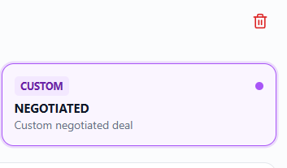

# WINDOW COMPANIES MANAGEMENT SYSTEM (CRM)

<div align="center">


[](https://vitejs.dev/)
[](https://react.dev/)
[](https://www.typescriptlang.org/)
[](https://supabase.com/)
[](https://tailwindcss.com/)
[](#-project-ownership)

<p align="center">
  <b>An enterprise-grade Commercial CRM, Hotel Contracting Engine, and Dynamic Rate Distribution Platform built exclusively for WINDOW COMPANIES (PVT) LTD.</b>
</p>

</div>

---

## 👤 Project Ownership & Credits

| Project Lead & Architect | Organization | Deployment Status |
| :--- | :--- | :--- |
| **Nethshan Dulmin Bulegoda** | **WINDOW COMPANIES (PVT) LTD.** | **Production Ready (Vercel & Supabase Cloud)** |

> **Proprietary Notice:**  
> This software, its architectural source code, data schemas, rate calculators, and assets are owned by **Nethshan Dulmin Bulegoda** and **WINDOW COMPANIES (PVT) LTD.** Unauthorized distribution, copying, or extraction of code is strictly prohibited.

---

## 📸 System Previews

<div align="center">
  <table>
    <tr>
      <td width="50%">
        <h4 align="center">🏢 Executive Dashboard & Field Activity</h4>
        
      </td>
      <td width="50%">
        <h4 align="center">📊 Dynamic Rate Sheet & Email Dispatch</h4>
        
      </td>
    </tr>
    <tr>
      <td colspan="2" align="center">
        <h4 align="center">🔐 Zero-Trust Authentication & RBAC</h4>
        
      </td>
    </tr>
  </table>
</div>

---

## 🌟 Key Features & Functional Modules

### 1. 🏨 Hotel & Inventory Portfolio Management
- **12+ Premier Partner Hotels:** Directory with contact information, addresses, amenities, and room inventories.
- **Strict Seasonal Calendars:** Non-overlapping validity windows (`Peak`, `High`, `Low`, `Shoulder`) with database-enforced integrity.
- **Contract Vault:** Secure storage for signed contractual agreements, commission percentages, and legal clauses.

### 2. 🌍 Travel Agencies & Market Hierarchy (3-Tier)
- **Hierarchy:** `Travel Agency` &rarr; `Market / Desk` (e.g., UK, Germany, CIS, Domestic) &rarr; `Contact Person / Reservation Officer`.
- Over **290+ Travel Agencies** and **980+ Direct Contacts** pre-seeded with instant search and filtering.
- Track personalized direct line numbers, direct WhatsApp links, and primary reservation desks.

### 3. 💼 Sales Visits & Team Activity Tracker
- **Field Visit Logging:** Sales representatives log physical agency visits, specific hotels discussed, discussion notes, and next follow-up dates.
- **Team Visits Hub (`/team-activities`):** Comprehensive view of team activities with date ranges, salesman filters, and instant CSV export.
- **Offline Resilience:** Instant local sync ensures visit notes are never lost even during spotty mobile connectivity.

### 4. 📈 Dynamic Rate Engine & Custom Quotations
- **Tiered Rate Categories:** Standardized pricing categories:
  - 🟢 **GREEN Rate** (Normal Tariff)
  - 🔴 **RED Rate** (Discounted / Aggressive Market Tariff)
  - 🟡 **YELLOW Rate** (Premium High-Demand Tariff)
  - 🟣 **CUSTOM Rate** (Partner-specific negotiated contracts)
- **Real-Time Rate Calculator:** Computes Single/Double/Triple occupancy with meal plan supplements (`RO`, `BB`, `HB`, `FB`, `AI`), tax structures, and company markups.

### 5. 📧 Branded Rate Sharing & Automated Email Composer
- **Instant Quotation Formatter:** Generates clean, professional emails with company branding, occupancy breakdown, child policies, and cancellation terms.
- **Recipient Resolution:** Seamlessly dispatches rates to:
  - An entire travel agency
  - A regional market desk
  - A specific reservation officer
  - Customized checkbox groupings
- **Email Handoff:** Dispatches directly via system mail client (`mailto:`) or web client (Gmail).

### 6. ✅ Employee Daily Tasks & Productivity
- **Admin Task Delegation:** Assign tasks with priority (`LOW`, `MEDIUM`, `HIGH`, `URGENT`), due dates, and operational categories.
- **One-Click Task Completion:** Staff can mark tasks as completed (`Mark as Done`) directly from the Dashboard or Tasks Hub.
- **Activity & Blocker Reporting:** Flag blockers with automatic management notifications.

### 7. 📥 Excel Bulk Import & Data Synchronization
- **Browser-side Spreadsheet Engine:** Bulk import Hotels, Seasons, Agencies, Markets, or Members via `.xlsx` spreadsheets.
- **Data Validation:** Checks for duplicate emails, invalid dates, and broken relations before uploading to the database.

---

## 🛡️ Security Architecture & Role-Based Access Control (RBAC)

The system is engineered using a **Zero-Trust Security Architecture**:

- **PostgreSQL Row Level Security (RLS):** Every single table is guarded by strict RLS policies. Unauthenticated or malicious requests are rejected at the database level (`42501 Unauthorized`).
- **Role Permissions:**
  - 👑 **ADMIN:** Complete control over employee provisioning, user access, hotel contracts, audit trails, and system settings.
  - 👔 **STAFF / SALES:** Access to agency contacts, log field visits, manage assigned daily tasks, calculate rates, and generate rate quotations.
- **Credential Isolation:** The Supabase `service_role` key is strictly kept off the client code. The client only consumes the public `anon` publishable key with authenticated JWT validation.

---

## 🛠️ Technology Stack

| Layer | Technologies |
| :--- | :--- |
| **Frontend Framework** | **React 19** with **TypeScript 5.8** |
| **Build Tool & Bundler** | **Vite 6** (ESM, Optimized Production Chunks) |
| **Styling & Design System** | **Tailwind CSS 3.4**, Custom Radix Gradients, Lucide Icons |
| **Database & Auth** | **Supabase Cloud (PostgreSQL 15+)**, PostgREST, Row-Level-Security |
| **Spreadsheets & Data** | **SheetJS (xlsx)** for high-speed client-side Excel processing |
| **Deployment** | **Vercel Cloud** with Single-Page Application (SPA) edge routing |

---

## 🚀 Getting Started

### 1. Prerequisites
- **Node.js:** `v18.0.0` or higher
- **npm:** `v9.0.0` or higher

### 2. Installation
```bash
# Clone the repository
git clone https://github.com/DulminDW/CRM.git

# Enter the project directory
cd CRM

# Install dependencies
npm install
```

### 3. Environment Configuration
Create a `.env.local` file in the root directory:
```env
VITE_SUPABASE_URL=https://your-supabase-project.supabase.co
VITE_SUPABASE_PUBLISHABLE_KEY=your-supabase-anon-key
```

### 4. Run Development Server
```bash
npm run dev
```
Open [http://localhost:5173](http://localhost:5173) in your browser.

### 5. Production Build
```bash
npm run build
```

---

## 📁 Project Directory Structure

```text
CRM/
├── docs/                   # Documentation & image previews
│   └── images/             # Visual screenshots for README
├── public/                 # Static web assets
├── src/
│   ├── components/         # Reusable UI components
│   │   ├── common/         # Protected routes, error boundaries
│   │   ├── hotels/         # Hotel details and rate modals
│   │   ├── layout/         # Header, Navbar, Sidebar
│   │   ├── rates/          # Rate tables, email composers, quote viewers
│   │   └── visits/         # Sales activity & visit logger modals
│   ├── contexts/           # React Context (AuthContext)
│   ├── hooks/              # Custom hooks (useAuth)
│   ├── pages/              # Application views & pages
│   │   ├── DashboardPage.tsx       # Main executive overview
│   │   ├── HotelsPage.tsx          # 12 Partner hotels
│   │   ├── TravelAgenciesPage.tsx  # 290+ Agencies directory
│   │   ├── ShareRatesPage.tsx      # Dynamic rate circular & email dispatch
│   │   ├── TeamActivitiesPage.tsx  # Salesman visit tracking & reporting
│   │   ├── TasksPage.tsx           # Daily work tasks management
│   │   ├── RateCalculatorPage.tsx  # Tariff computation engine
│   │   └── EmployeesPage.tsx       # Staff directory & provisioning
│   ├── services/           # Supabase REST and RPC API service layers
│   ├── types/              # TypeScript interface definitions
│   └── utils/              # Excel parsers, template generators, formatters
├── supabase/               # Database migrations, seed scripts, SQL functions
│   └── migrations/         # 31 structured database migration files
└── vercel.json             # Vercel SPA deployment rules
```

---

## 👨‍💻 Author & Owner

**Nethshan Dulmin Bulegoda**  
*Lead Developer & System Architect*  
WINDOW COMPANIES (PVT) LTD.  
- GitHub: [@DulminDW](https://github.com/DulminDW) / [@Bulee048](https://github.com/Bulee048)

---

<div align="center">
  <sub>© 2026 <b>WINDOW COMPANIES (PVT) LTD.</b> All Rights Reserved. Engineered with precision.</sub>
</div>
