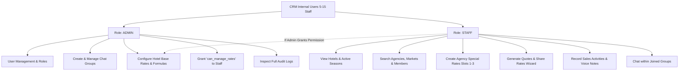
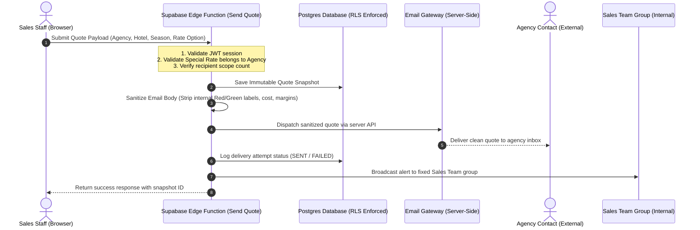

# WINDOW COMPANIES CRM — SECURITY ARCHITECTURE SPECIFICATION

**Document Version:** 1.0.0  
**Status Date:** November 02, 2026  
**Document Classification:** Internal Confidential — Architectural Blueprint  
**Primary Source of Truth:** `WINDOW_COMPANIES_CRM_COMPLETE_PROJECT_HANDOVER.md`

---

## 1. Executive Summary & Core Security Principles

WINDOW COMPANIES CRM is an internal operational platform containing confidential partner hotel rates, negotiated travel agency contracts, special pricing tiers (Slots 1, 2, 3), employee communications, and historical quotes. 

Because leakage of confidential hotel rate tiers or agency discounts could cause commercial damage, development follows ten mandatory security tenets:

1. **Zero Trust in Client-Supplied Data:** The browser is an untrusted environment. All pricing calculations, email dispatches, and authorization checks must execute on trusted server-side infrastructure (PostgreSQL RLS / Supabase Edge Functions).
2. **Default-Deny Access:** All database tables and storage buckets are closed by default (`ENABLE ROW LEVEL SECURITY`). Access is permitted only through explicit, verified policies.
3. **Least-Privilege Authorization:** Staff members only receive permissions strictly required for their role.
4. **Server-Side Permission Enforcement:** Hiding a button in React does not constitute security. All mutations require server-side token validation.
5. **Separation Between Frontend and Privileged Backend Operations:** The Supabase `service_role` key, email provider API keys, and private certificates must never touch the browser client bundle.
6. **No Hard-Coded Credentials:** All secrets reside in server-managed environment variables; `.gitignore` strictly excludes secret-bearing files.
7. **No Sensitive Information in Logs:** Rate amounts, customer contact PII, passwords, and tokens are scrubbed from telemetry and error traces.
8. **No Direct Cross-Tenant / Cross-Agency Access:** A special negotiated rate for Agency A must never be queryable or shareable with Agency B.
9. **Secure Handling of Attachments & Voice Notes:** Media files are stored in private buckets with short-lived signed URLs; direct public URL access is prohibited.
10. **Defense in Depth:** Multiple independent security layers (network, authentication, RLS, input sanitization, and audit logs) ensure that no single failure compromises the system.

---

## 2. Assets Requiring Protection

| Asset Category | Description | Impact of Breach / Leak |
| :--- | :--- | :--- |
| **Confidential Hotel Rates** | Red (Lowest), Green (Normal), Yellow (Highest) tiers, base calculations (HB Double base, supplements/reductions). | Severe commercial disadvantage with partner hotels and competitors. |
| **Special Negotiated Rates** | Agency-specific Special Rates (Slots 1, 2, 3) negotiated with specific travel agencies. | Breach of non-disclosure, loss of partner trust, contract termination. |
| **Agency Member Contacts** | ~1,000 agency contact profiles (names, direct phone numbers, personal business emails). | Commercial poaching by competitors, spam vulnerability. |
| **Historical Quote Snapshots** | Exact snapshots of quotes sent to contacts with timestamp, salesperson, and prices. | Dispute over contractual commitments; tampering risk. |
| **Internal Sales & Chat Records** | Internal sales activities, voice notes, WhatsApp-style team chat discussions. | Exposure of company strategy, internal negotiations, and employee privacy. |
| **Third-Party API Credentials** | Supabase Service Role Key, Resend/SendGrid API keys, transcription keys. | Complete database takeover or mail server hijacking. |

---

## 3. User Roles & Permission Boundaries



### Detailed Role Definitions:
- **Admin:**
  - Full system administration.
  - Can assign and revoke user roles (`ADMIN`, `STAFF`).
  - Controls the `can_manage_rates` permission flag.
  - Only role permitted to create internal team chat groups.
  - Has visibility over system-wide audit records.
- **Staff:**
  - Can view partner hotels, active seasons, and standard rate tables.
  - Can view and search travel agencies, markets, and contacts.
  - Can create and negotiate agency-specific Special Rates (Slots 1, 2, 3) without admin pre-approval.
  - Can dispatch rate quotes using the 7-step wizard.
  - Cannot edit protected hotel base rate formulas unless explicitly granted `can_manage_rates` by an Admin.
- **Agency Members / External Contacts:**
  - **Zero Login Access.** Agency contacts are purely contact records stored in the CRM. They do not have credentials, cannot authenticate, and have no direct access to the database or API.

---

## 4. Main Attack Surfaces & Mitigation Matrix

| Attack Vector | Threat Scenario | Mitigation Strategy |
| :--- | :--- | :--- |
| **Frontend Key Extraction** | An attacker inspects client bundle to extract Supabase service keys or email provider keys. | Only `VITE_SUPABASE_ANON_KEY` is in bundle. Service role keys and email provider tokens are strictly restricted to Supabase Edge Functions. |
| **Client-Side Parameter Tampering** | A user alters JavaScript variables to force a discount or bypass rate editing restrictions. | Postgres Row Level Security (RLS) rejects unauthorized UPDATE/INSERT statements at the database level, regardless of frontend code. |
| **Confidential Rate Leakage via Quote Email** | An external agency recipient receives an email showing internal color codes (Red/Green/Yellow) or profit margins. | Server-side email rendering engine explicitly strips all internal color tags, margins, and notes, outputting only approved customer-facing price lines. |
| **Cross-Agency Special Rate Leakage** | A salesperson mistakenly quotes Agency B's negotiated rate to Agency A. | Server-side validation during quote generation confirms that `special_rate.agency_id == quote.recipient_agency_id`. |
| **Malicious Media Uploads** | An attacker uploads an executable file disguised as an audio voice note or chat image. | Supabase Storage bucket policies enforce allowed MIME types (`audio/webm`, `audio/mp4`, `image/jpeg`, `image/png`) and strict size caps (10MB). |
| **Privilege Escalation** | A staff member issues an API call modifying their own role to `ADMIN` in `user_profiles`. | Postgres RLS with `WITH CHECK (auth.uid() IN (SELECT id FROM profiles WHERE role = 'ADMIN'))` blocks self-modification of roles. |
| **Mass Contact Scraping** | An internal account is compromised and begins mass-dumping the 1,000+ contact records. | API rate limiting and query auditing detect anomalous bulk queries. |

---

## 5. Planned Supabase Row Level Security (RLS) Model

*(To be implemented in Phase 2 upon user approval — Blueprint documented below)*

Every exposed table in PostgreSQL will have RLS enabled:

```sql
-- Architectural Blueprint for Future Phase 2 Migration
ALTER TABLE public.travel_agencies ENABLE ROW LEVEL SECURITY;
ALTER TABLE public.agency_markets ENABLE ROW LEVEL SECURITY;
ALTER TABLE public.agency_members ENABLE ROW LEVEL SECURITY;
ALTER TABLE public.hotels ENABLE ROW LEVEL SECURITY;
ALTER TABLE public.hotel_seasons ENABLE ROW LEVEL SECURITY;
ALTER TABLE public.hotel_rates ENABLE ROW LEVEL SECURITY;
ALTER TABLE public.agency_special_rates ENABLE ROW LEVEL SECURITY;
ALTER TABLE public.quote_snapshots ENABLE ROW LEVEL SECURITY;
ALTER TABLE public.sales_activities ENABLE ROW LEVEL SECURITY;
ALTER TABLE public.chat_groups ENABLE ROW LEVEL SECURITY;
ALTER TABLE public.chat_messages ENABLE ROW LEVEL SECURITY;
ALTER TABLE public.notifications ENABLE ROW LEVEL SECURITY;
```

### RLS Policy Rules:
1. **Default Deny:** If no policy matches, all operations return empty or fail.
2. **Authenticated Internal Identity:** Every policy requires `auth.role() = 'authenticated'` and checks that `auth.uid()` exists in `public.user_profiles` with `status = 'ACTIVE'`.
3. **Rate Management Protection:**
   - `SELECT` on `hotel_rates`: Allowed for all active staff.
   - `INSERT / UPDATE / DELETE` on `hotel_rates`: Allowed only if `auth.uid()` has `role = 'ADMIN'` OR `can_manage_rates = true` in `public.user_permissions`.
4. **Chat Group Membership Isolation:**
   - `SELECT / INSERT` on `chat_messages`: Allowed only if `auth.uid()` is present in `chat_group_members` for that `group_id`.
5. **Private Storage Buckets:**
   - Files are stored with paths prefixed by `group_id/` or `activity_id/`. Storage RLS verifies membership before generating signed URLs.

---

## 6. Secret Management & Pipeline Safeguards

- **Frontend Environment Variables (`.env.example`):**
  - Only variables prefixed with `VITE_` are included.
  - Only client-safe values (`VITE_SUPABASE_URL`, `VITE_SUPABASE_ANON_KEY`) are permitted.
  - The Anon key relies on Postgres RLS to enforce authorization.
- **Server-Side Environment Variables:**
  - Supabase `service_role` key, email provider keys (e.g., Resend/SendGrid), and transcription API tokens reside strictly in Supabase Edge Function environment secrets or Vercel serverless environment settings.
- **Git Repository Safeguards:**
  - `.gitignore` strictly rejects `.env`, `.env.*` (except `.env.example`), `.pem`, `.key`, and database dumps.
  - Automated file scans ensure no accidental credentials enter source control.

---

## 7. Secure Email Architecture (Quote Distribution)



### Critical Email Security Rules:
- **No Direct Client Dispatch:** The frontend never connects to an SMTP server or third-party email API directly.
- **Body Sanitization:** External emails must contain only approved commercial wording. Internal rate classifications (Red/Green/Yellow) must never appear in customer emails.
- **Snapshot Immutability:** Once a quote is generated, an exact, immutable snapshot is persisted. Subsequent changes to hotel base rates or seasonal calculations will not overwrite historical quote records.

---

## 8. Audit Logging & Compliance Strategy

1. **Rate Revisions:** Changes to base rates, formulas, or special rate agreements are recorded in an audit table with:
   - `changed_by` (User UUID)
   - `timestamp` (UTC)
   - `entity_type` and `entity_id`
   - `old_values` (JSONB)
   - `new_values` (JSONB)
2. **Quote Dispatch Log:** Every quote email generates a permanent log entry containing sender ID, recipient list, quote snapshot reference, and delivery status.
3. **Privacy Scrubbing:** Passwords, tokens, and sensitive authentication headers are never written to server console logs.

---

## 9. Remaining Architectural Decisions & Approvals

The following decisions require explicit confirmation from company leadership before Phase 2 implementation:
1. **Email Service Provider:** Selection of email provider (e.g. Resend, SendGrid, Amazon SES) and domain verification status (`@windowcompanies...`).
2. **Voice Transcription Engine:** Selection of transcription provider (e.g. OpenAI Whisper, Google Cloud Speech-to-Text), budget caps, and language prioritization (English, Sinhala, Singlish).
3. **Data Retention Policy:** Confirmation of retention periods for historical chat audio, voice notes, and quote snapshots.
4. **Approval for Cloud Supabase Setup:** Confirmation to create official company Supabase project with zero test data pollution.
