# DATABASE DESIGN & ENTITY RELATIONSHIP MODEL
**WINDOW COMPANIES MANAGEMENT SYSTEM**  
*Database Engine:* Supabase PostgreSQL 15+  
*Version:* 2.0.0 — November 13, 2026

---

## 1. Complete Entity Relationship Diagram (Mermaid)

```mermaid
erDiagram
    user_profiles ||--o{ user_permissions : "granted"
    user_profiles ||--o{ audit_logs : "performed_action"
    user_profiles ||--o{ excel_import_history : "started_import"
    user_profiles ||--o{ hotel_contracts : "created_contract"
    user_profiles ||--o{ custom_rate_templates : "created_template"
    user_profiles ||--o{ rate_calculation_setups : "created_setup"
    user_profiles ||--o{ quotes : "sent_quote"

    travel_agencies ||--|{ agency_markets : "partitions"
    travel_agencies ||--|{ agency_members : "employs"
    agency_markets ||--|{ agency_members : "contains_contacts"

    hotels ||--|{ hotel_seasons : "defines_seasons"
    hotels ||--o{ hotel_contracts : "agrees_contracts"
    hotels ||--o{ hotel_rate_sheets : "publishes_rates"
    hotels ||--o{ hotel_rate_configs : "configures_formulas"
    hotels ||--o{ custom_rate_templates : "has_templates"

    hotel_seasons ||--o{ hotel_rate_sheets : "scoped_to"
    hotel_seasons ||--o{ hotel_rate_configs : "scoped_to"
    hotel_seasons ||--o{ hotel_contract_seasons : "applies_to"

    hotel_contracts ||--|{ hotel_contract_seasons : "associates"
    hotel_contracts ||--o{ hotel_contract_conditions : "stipulates"
    hotel_contracts ||--o{ hotel_contract_documents : "attaches"
    hotel_contracts ||--o{ hotel_contract_versions : "versions"
    hotel_contracts ||--o{ hotel_rate_configs : "references"

    hotel_rate_sheets ||--|{ hotel_rate_components : "contains"
    hotel_rate_sheets ||--|{ hotel_rate_outputs : "yields"

    travel_agencies ||--o{ quotes : "receives_quotes"
    quotes ||--|{ quote_recipients : "targets"
    quotes ||--|{ quote_items : "specifies_rates"
    quotes ||--o{ quote_email_attempts : "tracks_dispatch"
```

---

## 2. Table Catalog & Schema Mapping

The database comprises 22 relational tables organized into cohesive business domains:

### Module 1: User Identity & Permissions
1. `user_profiles` – Internal employee accounts linked 1:1 with `auth.users`. Holds full name, role (`ADMIN` / `STAFF`), department, and active status.
2. `user_permissions` – Granular capabilities (`CAN_MANAGE_RATES`, `CAN_MANAGE_USERS`, `CAN_CREATE_CHAT_GROUPS`).

### Module 2: Travel Agency Hierarchy
3. `travel_agencies` – Master partner agencies and tour operators. Unique by `name`.
4. `agency_markets` – Regional desks partitioned per agency. Composite unique key `(agency_id, market_name)` and `(id, agency_id)`.
5. `agency_members` – Contact personnel. Composite foreign key `FOREIGN KEY (market_id, agency_id) REFERENCES agency_markets(id, agency_id)` guarantees market-agency integrity.

### Module 3: Hotels & Seasons
6. `hotels` – Partner properties (Mount Randholee, Serenique, Rivendell, etc.). Unique by `hotel_name`.
7. `hotel_seasons` – Seasonal windows per hotel. Constraint `CHECK (date_to > date_from)` and composite key `(id, hotel_id)`.

### Module 4: Contracts & Documents
8. `hotel_contracts` – Master commercial contracts with validity periods, currencies, and version numbers.
9. `hotel_contract_seasons` – Many-to-many junction table linking contracts to multiple operational hotel seasons.
10. `hotel_contract_conditions` – Structured commercial terms with `is_internal_only` flag.
11. `hotel_contract_documents` – Attached contract PDF/Word documents stored in `contract-documents`.
12. `hotel_contract_versions` – Immutable version snapshots of agreed terms.

### Module 5: Rate Configurations & Formulas
13. `hotel_rate_sheets` – Master rate versions. Enforces single active published sheet per hotel-season.
14. `hotel_rate_components` – Granular input component prices.
15. `hotel_rate_outputs` – Calculated output prices (Double HB, Single, Triple, BB).
16. `hotel_rate_configs` – Hotel-specific pricing components (HB Base, Single Red, Triple Supp, BB Red).
17. `custom_rate_templates` – Commercial templates (`Custom 1, 2, 3`) with minimum room-night conditions.
18. `agency_special_rates` – Agency-specific negotiated VIP slots (`Special Rate 1, 2, 3`).
19. `rate_calculation_setups` – User-created flexible calculation setups.

### Module 6: Quotes & Rate History
20. `quotes` – Frozen quote headers with lifecycle status (`DRAFT`, `OPENED_IN_EMAIL_APP`, `USER_CONFIRMED_SENT`), email subject, HTML, plain-text, and device confirmation audit metadata.
21. `quote_recipients` – Frozen recipient contact snapshots.
22. `quote_items` – Frozen rate line items with hotel name, season label, contract reference, and currency.
23. `quote_email_attempts` – Retry and dispatch log per quote.

### Module 7: Audit & Bulk Import Logs
24. `audit_logs` – Audit trail with trigger-enforced `actor_id := auth.uid()`.
25. `excel_import_history` – Bulk Excel import operation log tracking rows, results, and error summaries.

---

## 3. Data Integrity & Composite Key Constraints

To prevent orphan records and cross-tenant leakage:
- **Composite FK 1:** `agency_members(market_id, agency_id)` references `agency_markets(id, agency_id)`. Prevents assigning a contact to a market desk that belongs to another agency.
- **Composite FK 2:** `hotel_rate_sheets(season_id, hotel_id)` references `hotel_seasons(id, hotel_id)`. Guarantees rate sheets only apply to seasons of that specific hotel.
- **Composite FK 3:** `hotel_rate_configs(season_id, hotel_id)` references `hotel_seasons(id, hotel_id)`. Ensures pricing formula components match the property's operational calendar.
- **Composite FK 4:** `hotel_contract_seasons(season_id, hotel_id)` references `hotel_seasons(id, hotel_id)`. Prevents associating a contract with a season belonging to a different hotel.

