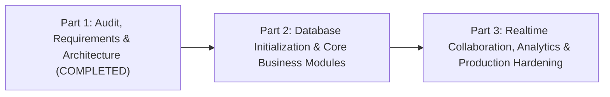

# SYSTEM DEVELOPMENT ROADMAP
**WINDOW COMPANIES MANAGEMENT SYSTEM**  
*Implementation Strategy:* Phased, Incremental, Non-Destructive  
*Version:* 2.0.0 — November 13, 2026

---

## 1. Roadmap Overview & Timeline

The system development is structured into three structured, sequential master parts:

---

## 2. Part 1: Audit, Requirements & Architecture (Status: COMPLETED)
- [x] Complete project source code and database audit (`docs/PROJECT_AUDIT.md`).
- [x] Complete business requirements specification (`docs/REQUIREMENTS.md`).
- [x] System architecture design with Mermaid diagrams (`docs/SYSTEM_ARCHITECTURE.md`).
- [x] Complete 22-table database schema specification and ER model (`docs/DATABASE_DESIGN.md`).
- [x] Gap analysis and module classification (`docs/IMPLEMENTATION_STATUS.md`).
- [x] Document unresolved business questions (`docs/OPEN_QUESTIONS.md`).
- [x] Author technical implementation roadmap (`docs/DEVELOPMENT_ROADMAP.md`).
- [x] Build automated test suite with 13 test suites and 127 assertions passing (`scripts/run-tests.cjs`).

---

## 3. Part 2: Database Initialization & Core Business Execution (Next Phase)

### Sprint 2.1: Safe Database Initialization & Storage Vault
1. Deploy pending migrations in strict dependency order:
   - `000009_rate_management_foundation.sql`
   - `000010_contracts_and_custom_rate_templates.sql`
   - `000011_rate_calculation_setups_and_audit.sql`
   - `000012_harden_audit_actor_identity.sql`
   - `000013_contract_management_system.sql`
   - `000014_hotel_rate_configs_and_history.sql`
   - `000015_excel_bulk_import_history.sql`
2. Create and configure private Supabase Storage bucket `contract-documents`.
3. Provision authorized initial Administrator in `user_profiles` and grant `CAN_MANAGE_RATES`.

### Sprint 2.2: Master Data Ingestion & Partner Seeding
1. Ingest the 12 partner hotel properties via Bulk Import or seed script:
   - Mount Randholee, Serenique, Rivendell, Manarala, Highland Stone House, Horton Heights, Deer Park, Agbo, Pearl Grand, Rathna Beach, Grand Beragala, The Thinnai.
2. Ingest operational seasons for 2026/2027.
3. Import primary travel agencies, regional market desks, and contact members (~1,000 records).

### Sprint 2.3: Internal Employee Management Module
1. Build dedicated `/employees` administration page for Admins:
   - Invite employee by email and full name.
   - Assign roles (`ADMIN`, `STAFF`) and granular capability permissions (`CAN_MANAGE_RATES`).
   - Activate/deactivate employee accounts.
   - Initiate secure password reset recovery links.
2. Ensure strict backend RLS enforcement on employee profile mutations.

### Sprint 2.4: Master Contract Management Integration
1. Connect `ContractsPage.tsx` and `ContractsView.tsx` to live `hotel_contracts` table.
2. Connect document upload component to `contract-documents` bucket.
3. Verify condition segregation (`is_internal_only`) in email generation.

### Sprint 2.5: Rate Management & Formula Components
1. Connect `hotelRateConfigService.ts` to `hotel_rate_configs` table.
2. Connect `customRateService.ts` to `custom_rate_templates` table.
3. Verify live quote snapshots in `ShareRatesPage.tsx` with immutable history archiving.

---

## 4. Part 3: Collaboration, Intelligence & Production Hardening

### Sprint 3.1: Daily Task Assignment & Workflow Tracker
1. Create `tasks` and `task_assignments` database schema with RLS.
2. Build daily task assignment interface in `/sales-activities`:
   - Assign tasks to specific employees with due dates, priority, and progress status.
   - Real-time task notifications for assigned staff.

### Sprint 3.2: Realtime Team Chat & Group Channels
1. Create `chat_groups`, `chat_members`, and `chat_messages` tables.
2. Implement Supabase Realtime WebSocket subscriptions in `TeamChatPage.tsx`.
3. Support direct 1:1 employee chats and agency-specific communication channels.

### Sprint 3.3: Sales Activities & Voice Note Logging
1. Create `sales_activities` table tracking agency interactions, meeting logs, and follow-ups.
2. Connect voice note recorder with browser Web Audio API and file storage.

### Sprint 3.4: Business Performance Reports & Analytics
1. Implement live SQL aggregation views for property coverage, rate distribution, and quote volume.
2. Replace mock charts in `AnalyticsPage.tsx` with live data feeds.

### Sprint 3.5: Final Security Audit, Penetration Testing & Deployment
1. End-to-end RLS security validation.
2. Production build optimization and Lighthouse performance audit.
3. Coordinate deployment to production Vercel environment.

