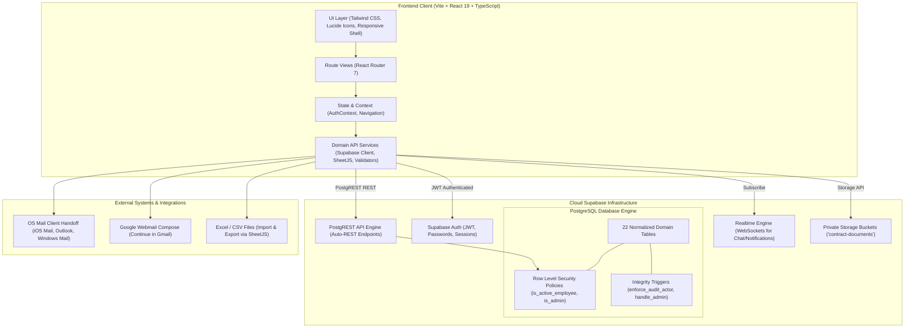

# SYSTEM ARCHITECTURE SPECIFICATION
**WINDOW COMPANIES MANAGEMENT SYSTEM**  
*Architecture Style:* Client-Side Single Page Application (SPA) with Cloud PostgreSQL & BaaS Backend  
*Version:* 2.0.0 — November 13, 2026

---

## 1. High-Level Architectural Diagram

---

## 2. Layered Component Architecture

### 2.1 Presentation & UI Layer
- **Framework:** React 19 SPA running under Vite.
- **Styling:** Tailwind CSS with custom navy (`#101828`), corporate blue (`#1455D9`), light grey borders (`#D9E0EA`), and accessible color contrasts.
- **Layout Shell:** `MainLayout.tsx` providing a fixed navy-styled responsive sidebar for desktop, drawer navigation for mobile/tablet, breadcrumb navbar with real-time RLS badge, and content container.
- **State Handling:** Loading spinners, empty data states with action buttons, contextual error alerts, and modal dialogs with focus trapping.

### 2.2 Routing & Access Control Layer
- **Router:** React Router DOM v7.
- **Route Guarding:** `ProtectedRoute.tsx` enforces:
  - Active authentication session.
  - Presence of provisioned, active employee profile (`is_active = TRUE`).
  - Role-based checking (`requiredRole="ADMIN"` for `/settings`, `/activity-log`).
  - Permission-based checking (`requiredPermission="CAN_MANAGE_RATES"` for `/rates`, `/special-rates`).

### 2.3 Service & Business Logic Layer
- **Client Library:** `@supabase/supabase-js` v2.
- **Separation of Concerns:**
  - `hotelService.ts` / `seasonService.ts`: Hotel property inventory and date range rules.
  - `agencyService.ts` / `marketService.ts` / `memberService.ts`: B2B hierarchy and email deduplication.
  - `contractService.ts`: Master contracts, version snapshots, and condition segregation.
  - `rateService.ts` / `hotelRateConfigService.ts` / `customRateService.ts`: Pricing matrix calculations.
  - `quoteService.ts`: Immutable frozen snapshots and email handoff statuses.
  - `bulkImportService.ts`: Excel template generation, file parsing, pre-flight validation, and batch execution.

### 2.4 Database & Security Layer
- **PostgreSQL 15+ Engine** hosted on Supabase.
- **Row-Level Security (RLS):** Every table has RLS enabled. Policies are backed by `SECURITY DEFINER` helper functions (`is_active_employee()`, `is_admin()`, `can_manage_rates()`).
- **Non-Repudiation Triggers:** `enforce_audit_actor_identity()` trigger guarantees that client requests cannot spoof `actor_id` in audit trails.

---

## 3. Storage & Document Architecture

- **Bucket:** `contract-documents`
- **Visibility:** **Strictly Private** (Public access disabled).
- **Security Policies:**
  - `SELECT`: Restricted to authenticated active employees (`is_active_employee()`).
  - `INSERT` / `UPDATE`: Restricted to users with rate management authority (`can_manage_rates()`).
  - `DELETE`: Restricted to system administrators (`is_admin()`).
- **File Types Allowed:** PDF (`.pdf`), Word Documents (`.doc`, `.docx`).
- **Max File Size:** 25MB per document.

---

## 4. Email Dispatch Architecture (Handoff Model)

The system purposefully utilizes a client-side device handoff model rather than exposing high-risk SMTP or transactional API credentials in frontend bundles:
1. **Pre-flight Review:** Staff reviews the generated HTML and plain-text rate table in the CRM preview modal.
2. **Device Email Application (`mailto:`):** Launches local email clients (Apple Mail, Microsoft Outlook, Windows Mail, Android Email) with pre-encoded headers (`to`, `cc`, `subject`, `body`).
3. **Continue in Gmail:** Opens `https://mail.google.com/mail/?view=cm` in a new tab with query-encoded fields.
4. **Audit State Progression:**
   `DRAFT` &rarr; `OPENED_IN_EMAIL_APP` &rarr; `USER_CONFIRMED_SENT`.

