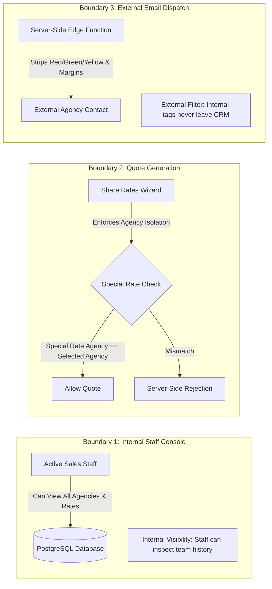

# WINDOW COMPANIES CRM — PROPOSED ROW LEVEL SECURITY (RLS) DESIGN (PHASE 2A REVISED)

**Document Version:** 1.1.0 (Architecture Design Only — Security Hardened)  
**Status Date:** November 02, 2026  
**Classification:** Internal Confidential — Security Specification  

> [!IMPORTANT]
> **PHASE 2A BOUNDARY NOTICE:**
> The policies, helper functions, and security definitions documented in this file are **PROPOSED ARCHITECTURAL DESIGNS ONLY**. 
> Row Level Security is **NOT** yet implemented, active, or executed in any live database. Implementation will take place in Phase 2B only after explicit user approval.

---

## 1. Zero-Trust & Default-Deny Security Model

In Supabase PostgreSQL, enabling Row Level Security ensures that if no policy matches a user's authenticated request, the database returns empty results or errors by default.

```sql
-- Design Rule: Every public CRM table (exactly 26 tables) will execute default-deny:
ALTER TABLE public.user_profiles ENABLE ROW LEVEL SECURITY;
ALTER TABLE public.user_permissions ENABLE ROW LEVEL SECURITY;
ALTER TABLE public.travel_agencies ENABLE ROW LEVEL SECURITY;
ALTER TABLE public.agency_markets ENABLE ROW LEVEL SECURITY;
ALTER TABLE public.agency_members ENABLE ROW LEVEL SECURITY;
ALTER TABLE public.hotels ENABLE ROW LEVEL SECURITY;
ALTER TABLE public.hotel_seasons ENABLE ROW LEVEL SECURITY;
ALTER TABLE public.hotel_rate_sheets ENABLE ROW LEVEL SECURITY;
ALTER TABLE public.hotel_rate_components ENABLE ROW LEVEL SECURITY;
ALTER TABLE public.hotel_rate_outputs ENABLE ROW LEVEL SECURITY;
ALTER TABLE public.agency_special_rates ENABLE ROW LEVEL SECURITY;
ALTER TABLE public.quotes ENABLE ROW LEVEL SECURITY;
ALTER TABLE public.quote_recipients ENABLE ROW LEVEL SECURITY;
ALTER TABLE public.quote_items ENABLE ROW LEVEL SECURITY;
ALTER TABLE public.quote_email_attempts ENABLE ROW LEVEL SECURITY;
ALTER TABLE public.sales_team_memberships ENABLE ROW LEVEL SECURITY;
ALTER TABLE public.notifications ENABLE ROW LEVEL SECURITY;
ALTER TABLE public.sales_activities ENABLE ROW LEVEL SECURITY;
ALTER TABLE public.sales_activity_attachments ENABLE ROW LEVEL SECURITY;
ALTER TABLE public.chat_groups ENABLE ROW LEVEL SECURITY;
ALTER TABLE public.chat_group_members ENABLE ROW LEVEL SECURITY;
ALTER TABLE public.chat_messages ENABLE ROW LEVEL SECURITY;
ALTER TABLE public.chat_message_attachments ENABLE ROW LEVEL SECURITY;
ALTER TABLE public.chat_message_mentions ENABLE ROW LEVEL SECURITY;
ALTER TABLE public.chat_read_receipts ENABLE ROW LEVEL SECURITY;
ALTER TABLE public.audit_logs ENABLE ROW LEVEL SECURITY;
```

---

## 2. Hardened SECURITY DEFINER Helper Functions

### 2.1 Threat Analysis of SECURITY DEFINER Functions
A PostgreSQL `SECURITY DEFINER` function executes with the privileges of the user that **created/owns** the function (typically `postgres` or `supabase_admin`), effectively bypassing RLS within the function's internal queries.

If not hardened, `SECURITY DEFINER` functions introduce severe security vulnerabilities:
1. **Search Path Hijacking:** If `search_path` is mutable, an attacker could create a malicious table/function in a temporary schema and trick the function into executing rogue code.
2. **Infinite RLS Recursion:** If an RLS policy calls a helper function that queries a table which triggers the same RLS policy, PostgreSQL terminates with a stack depth limit recursion error.
3. **Improper Public Execution:** If `PUBLIC` role retains `EXECUTE` privileges, unauthenticated or anonymous clients can invoke the function.
4. **NULL auth.uid() Traps:** When a query runs unauthenticated or outside a valid JWT session, `auth.uid()` evaluates to `NULL`. The function must cleanly return `FALSE`, never error or match rows.

### 2.2 Hardened PostgreSQL Helper Functions Specification

```sql
-- Revoke default public execution privileges on public functions
ALTER DEFAULT PRIVILEGES IN SCHEMA public REVOKE EXECUTE ON FUNCTIONS FROM PUBLIC;

-- Helper 1: is_active_employee()
-- Hardened with fixed search_path, NULL guard, and schema-qualified references
CREATE OR REPLACE FUNCTION public.is_active_employee()
RETURNS BOOLEAN
LANGUAGE sql
SECURITY DEFINER
SET search_path = public, pg_temp
STABLE
AS $$
  SELECT CASE 
    WHEN auth.uid() IS NULL THEN FALSE
    ELSE EXISTS (
      SELECT 1 FROM public.user_profiles
      WHERE id = auth.uid() AND is_active = TRUE
    )
  END;
$$;

-- Helper 2: is_admin()
-- Verifies the user has role = 'ADMIN' and is an active employee
CREATE OR REPLACE FUNCTION public.is_admin()
RETURNS BOOLEAN
LANGUAGE sql
SECURITY DEFINER
SET search_path = public, pg_temp
STABLE
AS $$
  SELECT CASE 
    WHEN auth.uid() IS NULL THEN FALSE
    ELSE EXISTS (
      SELECT 1 FROM public.user_profiles
      WHERE id = auth.uid() AND role = 'ADMIN' AND is_active = TRUE
    )
  END;
$$;

-- Helper 3: can_manage_rates()
-- Returns TRUE if user is an active Admin OR has CAN_MANAGE_RATES permission
CREATE OR REPLACE FUNCTION public.can_manage_rates()
RETURNS BOOLEAN
LANGUAGE sql
SECURITY DEFINER
SET search_path = public, pg_temp
STABLE
AS $$
  SELECT CASE 
    WHEN auth.uid() IS NULL THEN FALSE
    ELSE (
      public.is_admin() OR EXISTS (
        SELECT 1 
        FROM public.user_permissions p
        JOIN public.user_profiles u ON u.id = p.user_id
        WHERE p.user_id = auth.uid() 
          AND p.permission_key = 'CAN_MANAGE_RATES'
          AND u.is_active = TRUE
      )
    )
  END;
$$;

-- Helper 4: is_chat_group_member(p_group_id)
-- Verifies user is an enrolled member of the specified chat channel
CREATE OR REPLACE FUNCTION public.is_chat_group_member(p_group_id UUID)
RETURNS BOOLEAN
LANGUAGE sql
SECURITY DEFINER
SET search_path = public, pg_temp
STABLE
AS $$
  SELECT CASE 
    WHEN auth.uid() IS NULL OR p_group_id IS NULL THEN FALSE
    ELSE EXISTS (
      SELECT 1 FROM public.chat_group_members
      WHERE group_id = p_group_id AND user_id = auth.uid()
    )
  END;
$$;

-- Restrict function execution: Grant execute ONLY to the authenticated role
REVOKE EXECUTE ON FUNCTION public.is_active_employee() FROM PUBLIC;
REVOKE EXECUTE ON FUNCTION public.is_admin() FROM PUBLIC;
REVOKE EXECUTE ON FUNCTION public.can_manage_rates() FROM PUBLIC;
REVOKE EXECUTE ON FUNCTION public.is_chat_group_member(UUID) FROM PUBLIC;

GRANT EXECUTE ON FUNCTION public.is_active_employee() TO authenticated;
GRANT EXECUTE ON FUNCTION public.is_admin() TO authenticated;
GRANT EXECUTE ON FUNCTION public.can_manage_rates() TO authenticated;
GRANT EXECUTE ON FUNCTION public.is_chat_group_member(UUID) TO authenticated;
```

---

## 3. Revised Table-by-Table RLS Access Matrix (All 26 Tables)

| Module | Table Name | SELECT (Read) | INSERT (Create) | UPDATE (Modify) | DELETE (Remove) | Required Role & Integrity Enforcements |
| :--- | :--- | :--- | :--- | :--- | :--- | :--- |
| **1. Access** | `user_profiles` | Active Staff | Admin only | Admin only (Staff: self-avatar/phone only) | Prohibited (`RESTRICT`) | Staff cannot self-escalate role to `ADMIN`. |
| | `user_permissions` | Active Staff | Admin only | Admin only | Admin only | Controls rate-management permissions. |
| **2. Agency** | `travel_agencies` | Active Staff | Active Staff | Active Staff | Admin only | Master agency profiles; viewable by all company sales staff. |
| | `agency_markets` | Active Staff | Active Staff | Active Staff | Admin only | Regional market desks partitioned per agency. |
| | `agency_members` | Active Staff | Active Staff | Active Staff | Admin only | Contact profiles. Agency contacts have no login access. |
| **3. Hotels** | `hotels` | Active Staff | `can_manage_rates()`| `can_manage_rates()`| Admin only | Partner hotel inventory. |
| | `hotel_seasons` | Active Staff | `can_manage_rates()`| `can_manage_rates()`| Admin only | Seasonal validity date periods. |
| **4. Rates** | `hotel_rate_sheets` | Active Staff | `can_manage_rates()`| `can_manage_rates()` (Draft only)| Admin only (Draft only) | Published rate schedules are immutable. |
| | `hotel_rate_components`| Active Staff| `can_manage_rates()`| `can_manage_rates()` (Draft only)| `can_manage_rates()` (Draft only)| Formula inputs (base, reductions, supplements). |
| | `hotel_rate_outputs` | Active Staff | `can_manage_rates()`| `can_manage_rates()` (Draft only)| `can_manage_rates()` (Draft only)| Red, Green, Yellow pricing tiers. |
| | `agency_special_rates`| Active Staff (Internal)| Active Staff | Creator Staff or Admin | Admin only | Special slots 1-3. Admin approval not required to create. |
| **5. Quotes** | `quotes` | Active Staff | Active Staff | Creator Staff (`DRAFT` only)| Prohibited | Once lifecycle is `DISPATCHED`, quote is frozen. |
| | `quote_recipients` | Active Staff | Creator Staff | Prohibited | Prohibited | Frozen recipient email and name snapshots. |
| | `quote_items` | Active Staff | Creator Staff | Prohibited | Prohibited | Frozen room price and rate tier snapshots. |
| | `quote_email_attempts`| Active Staff| Edge Function only | Edge Function only | Prohibited | Email audit log; delivery tracked per recipient attempt. |
| **6. Alerts** | `sales_team_memberships`| Active Staff| Admin only | Admin only | Admin only | Fixed notification broadcast roster. |
| | `notifications` | Recipient staff (`user_id = auth.uid()`)| Edge Function / Trigger | Recipient staff (`is_read` flag)| Recipient staff | In-app alerts for quote shares and chat mentions. |
| **7. Sales** | `sales_activities` | Active Staff | Active Staff | Creator Staff or Admin | Admin only | Phone calls and discussion logs. Not a booking receipt. |
| | `sales_activity_attachments`| Active Staff| Creator Staff | Creator Staff | Admin only | Audio storage metadata and transcripts. |
| **8. Chat** | `chat_groups` | Enrolled Members (`is_chat_group_member`)| Admin only | Admin only | Admin only | Only Admins can create chat channels. |
| | `chat_group_members` | Enrolled Members| Admin only | Admin only | Admin only | Channel enrollment roster. |
| | `chat_messages` | Enrolled Members| Enrolled Members (`sender_id = auth.uid()`)| Prohibited | Admin only | Realtime message stream. |
| | `chat_message_attachments`| Enrolled Members| Enrolled Members | Prohibited | Admin only | Audio and image storage object references. |
| | `chat_message_mentions`| Enrolled Members| Enrolled Members | Prohibited | Admin only | `@name` mention tags. |
| | `chat_read_receipts` | Enrolled Members| User self (`user_id = auth.uid()`)| User self | User self | Unread message tracking cursor. |
| **9. Audit** | `audit_logs` | Admin only | System / Trigger only | Prohibited | Prohibited | Immutable audit log. Client write blocked. |

---

## 4. Distinction Between Internal Visibility, Agency Isolation, and External Email Filtering

A critical security principle in this CRM is distinguishing four separate operational boundaries:



1. **Internal Staff Visibility (Policy Choice):** Active sales employees can view all agency profiles and special rates in the internal console. This is a deliberate business requirement to prevent two salespeople from quoting contradictory rates to the same agency.
2. **Agency-Level Special Rate Isolation:** A negotiated Special Rate for Agency A must **never** be attached to a quote sent to Agency B. This isolation is guaranteed server-side in the quote generation logic and composite foreign keys.
3. **External Email Content Filtering:** The external agency contact only receives clean room names, meal plans, and net quoted amounts. Internal rate categories (`RED`, `GREEN`, `YELLOW`), base formulas, and profit margins are stripped server-side.
4. **Server-Side Authorization:** Email dispatch, speech transcription, and user role modifications run strictly in Edge Functions where service keys and email API keys are kept off the client.

---

## 5. Storage Security Architecture (`private-audio` & `private-chat`)

Voice notes (Sales Activities) and chat media (Team Chat) reside in two private Supabase Storage buckets:
- `private-audio`: Sales activity voice notes and recordings.
- `private-chat`: Chat media attachments and group audio notes.

### 5.1 Storage Rules & Threat Mitigations:
1. **Public Access:** Disabled (`public = false`). Direct HTTP access returns `403 Forbidden`.
2. **Structured Storage Paths:**
   - Sales Activity Audio: `activity/{activity_id}/{file_uuid}.webm`
   - Chat Attachments: `group/{group_id}/{message_id}/{file_uuid}.jpg`
3. **Download Authorization (Short-Lived Signed URLs):**
   - For `private-audio`: User must be an active company employee (`public.is_active_employee()`).
   - For `private-chat`: User must be an enrolled member of the group embedded in the folder path (`public.is_chat_group_member((storage.foldername(name))[2]::uuid)`).
4. **Upload Validation (Server-Side / Storage Policies):**
   - File extensions: Restricted to approved audio (`.webm`, `.mp4`, `.mp3`, `.ogg`, `.wav`) and image formats (`.jpg`, `.jpeg`, `.png`, `.webp`).
   - Size caps: 15MB for voice notes, 25MB for chat attachments.
5. **Path Traversal Prevention:** Storage policies reject path strings containing `../`, null bytes, or invalid UUID segments.

---

## 6. Audit Log Protection & Immutability

The `audit_logs` table provides accountability for sensitive rate modifications and administrative actions.

### Design Protections:
- **Client Insertion Prohibited:** Ordinary clients cannot issue `INSERT` statements to `audit_logs`. Logs are created via server-side database triggers or Edge Functions.
- **Client Modification Prohibited:** RLS policies provide **no** `UPDATE` or `DELETE` policies on `audit_logs`.
- **Secret Scrubbing:** Triggers writing to `old_values` and `new_values` must exclude sensitive keys (passwords, tokens, service keys).
- **Admin Read-Only:** Only users where `public.is_admin() = TRUE` can query audit records.
