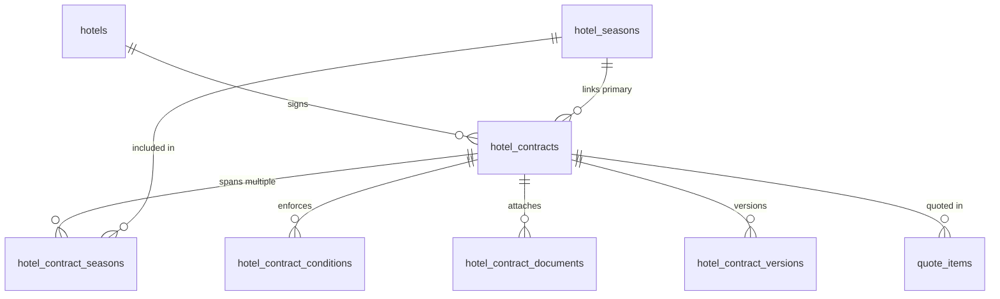

# Contract Management Architecture & Technical Specification
**Window Companies (Pvt) Ltd. — Management System & CRM**
*Phase 8 Technical Reference*

---

## 1. Executive Summary & Purpose
The Hotel Contract Management module establishes a single source of truth for hotel partner agreements across Sri Lanka. It governs commercial validity periods, associated seasons, structured conditions (cancellation, check-in, supplements), original contract documents, and immutable version snapshots.

It bridges property contracts directly into the Rate Management and Outward Rate Sharing dispatch pipeline while strictly enforcing confidentiality rules.

---

## 2. Database Schema Design (Draft Migration 000013)
The architecture builds on `hotel_contracts` created in migration `20261105000010_contracts_and_custom_rate_templates.sql` and introduces four specialized child tables:

### 2.1 Core Entities

1. **`hotel_contracts` (Master Registry)**:
   - `id` (UUID, PK)
   - `hotel_id` (UUID, FK -> `hotels`)
   - `season_id` (UUID, FK -> `hotel_seasons`, optional primary)
   - `contract_reference` (VARCHAR, Unique): E.g., `CTR-SIG-2026-001`
   - `contract_name` (VARCHAR): Descriptive agreement title
   - `valid_from` & `valid_to` (DATE): Exact validity boundary (`valid_to > valid_from`)
   - `status` (`DRAFT`, `ACTIVE`, `EXPIRED`, `TERMINATED`, `ARCHIVED`)
   - `currency` (CHAR(3), e.g., 'USD', 'EUR')
   - `terms_and_conditions` (TEXT): High-level commercial clauses
   - `internal_notes` (TEXT): Sensitive internal margins/commissions (RESTRICTED)
   - `version_number` (INTEGER, defaults to 1)

2. **`hotel_contract_seasons` (Multi-Season Mapping)**:
   - Allows a master annual or multi-month contract to govern multiple distinct operational seasons (e.g. Winter Peak, Winter Shoulder).

3. **`hotel_contract_conditions` (Structured Commercial Clauses)**:
   - `condition_category`: `CHECK_IN_OUT`, `CANCELLATION`, `CHILD_POLICY`, `PAYMENT`, `GALA_DINNER`, `GENERAL`, `SUPPLEMENT`.
   - `is_mandatory`: Boolean indicating if partner must acknowledge.
   - `is_internal_only`: **CRITICAL PRIVACY FLAG**. If `true`, clause is strictly hidden from travel agencies and quote exports.

4. **`hotel_contract_documents` (Private Document Metadata)**:
   - Stores metadata for original signed PDFs and rate matrices.
   - Stored in private Supabase Storage bucket `hotel-contracts`.

5. **`hotel_contract_versions` (Immutable Version Snapshots)**:
   - Whenever rates, conditions, or clauses are renegotiated, an immutable version snapshot is published (`v1.0`, `v2.0`, `v3.0`).
   - Prevents historical quote integrity corruption when an active contract changes.

---

## 3. Security & Access Control
- **Database RLS Policies**:
  - `hotel_contracts`: Authenticated employees can SELECT; only `ADMIN` or staff with `CAN_MANAGE_RATES` can INSERT, UPDATE, or DELETE.
  - Confidential fields (`internal_notes`, `is_internal_only = true`) are filtered in client-facing views and outgoing emails.
- **Audit Logging**:
  - Integrated via `adminActivityService.logActivity()` logging `CONTRACT_CREATED`, `CONTRACT_UPDATED`, `CONTRACT_VERSION_CREATED`, and `CONTRACT_DOCUMENT_UPLOADED`.

---

## 4. Frontend Integration
- **Contracts Console (`/contracts`)**:
  - Filterable by Hotel, Status, and Date.
  - Interactive drawer with tabs: `OVERVIEW`, `CONDITIONS`, `VERSIONS`, `DOCUMENTS`, and `NOTES`.
  - Responsive mobile drawer and cards.
- **Rate Sharing Integration (`/share-rates`)**:
  - Automatically queries active, date-valid contracts matching hotel and season.
  - Injects non-internal conditions into proposal preview and binds frozen contract reference into immutable quote snapshot.

