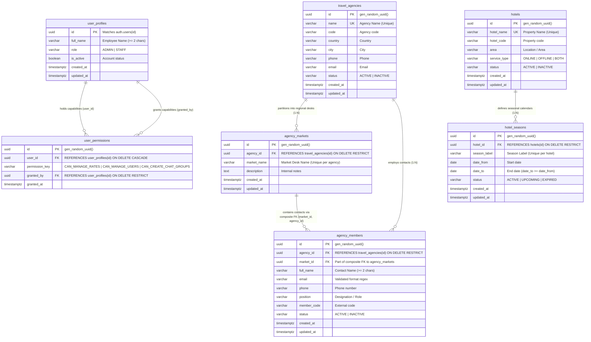
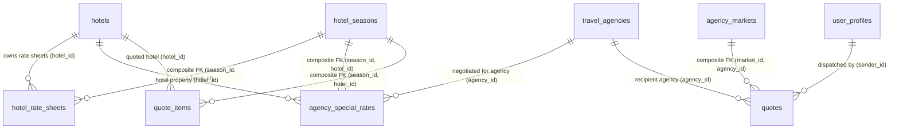

# WINDOW COMPANIES CRM — CORE DATABASE ERD (MODULES 1–3)

**Document Version:** 1.0.0  
**Status Date:** November 02, 2026  
**Classification:** Internal Technical Architecture Diagram  
**Primary Source of Truth:** `docs/database/001_initial_schema_DRAFT.sql`

---

## 1. Core Entity-Relationship Diagram (Modules 1, 2, and 3)

The following Mermaid diagram visualizes the primary keys, foreign keys, and composite relationships for the 7 core tables:
- `user_profiles`
- `user_permissions`
- `travel_agencies`
- `agency_markets`
- `agency_members`
- `hotels`
- `hotel_seasons`

---

## 2. Downstream Linkage Architecture (Modules 4 & 5 Integration)

The core tables established above integrate seamlessly into the remaining modules via composite foreign keys:

