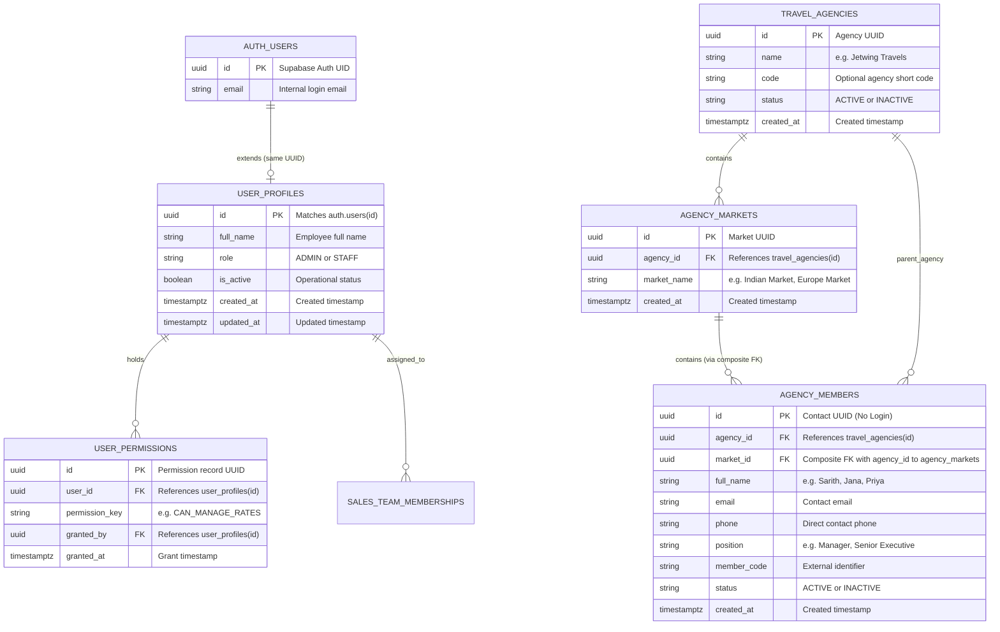
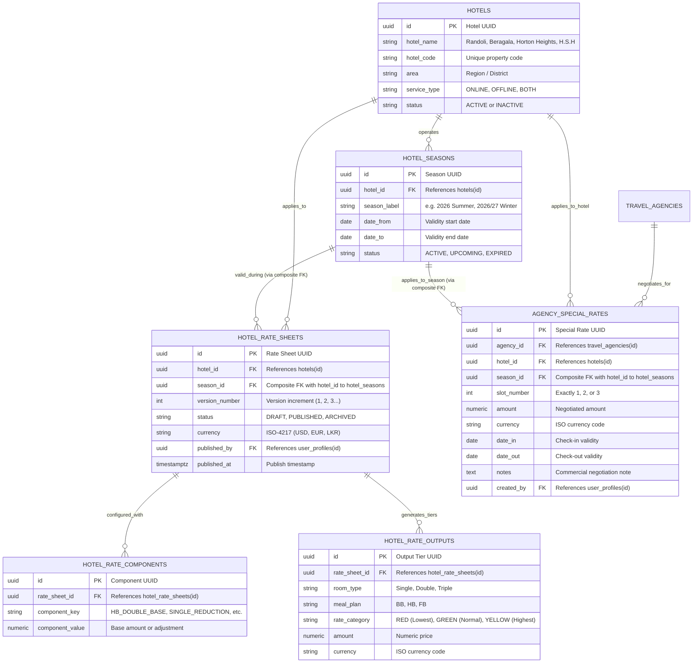
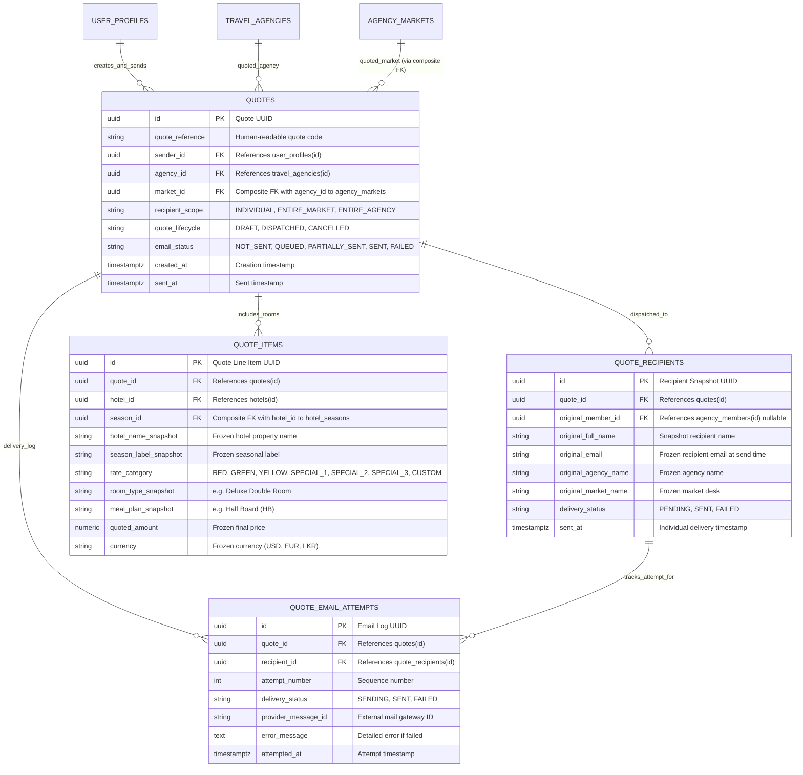
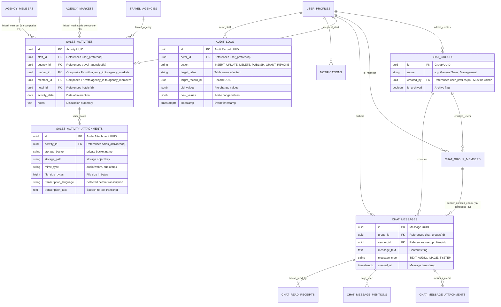

# WINDOW COMPANIES CRM — ENTITY RELATIONSHIP DIAGRAMS (PHASE 2A REVISED)

**Document Version:** 1.1.0 (Design Draft — Revised)  
**Status Date:** November 02, 2026  
**Notation:** Mermaid ER Diagram Syntax  
**Table Count:** Exactly 26 Tables Across 9 Modules  

---

## 1. Diagram 1: Employees, Authentication & Agency Contact Hierarchy

---

## 2. Diagram 2: Hotels, Seasons, Rate Versioning & Special Rates

---

## 3. Diagram 3: Rate Distribution & Immutable Quote Snapshots

---

## 4. Diagram 4: Team Chat, Notifications, Sales Activities & Audit Logs

