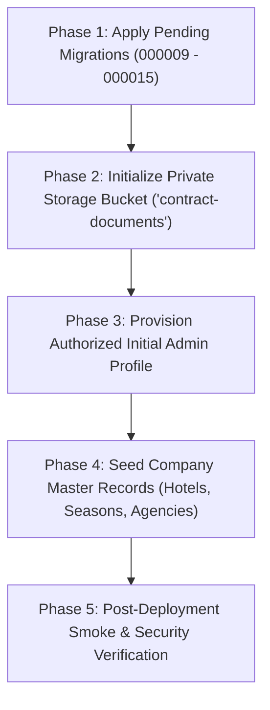

# DATABASE INITIALIZATION & DEPLOYMENT PLAN
**WINDOW COMPANIES MANAGEMENT SYSTEM**  
*Company:* Window Companies (Pvt) Ltd.  
*Document Version:* 1.0.0  
*Date:* November 11, 2026

---

## 1. Prerequisites & Safety Constraints

1. **Explicit User Approval:** No live database migration or seed script will be executed until the user explicitly responds with approval.
2. **Read-Only / Non-Destructive:** The live database will NOT be reset, dropped, or truncated.
3. **Secret Protection:** Secrets, service-role keys, and connection credentials from `.env.local` must remain confidential and must never be committed or written to documentation.
4. **Data Integrity:** Only authorized, real company structures will be seeded. No dummy or placeholder data will be inserted into production tables.

---

## 2. Ordered Deployment Sequence



---

## 3. Detailed Step-by-Step Execution Plan

### Phase 1: Deploy Pending SQL Migrations (Strict Order)
The following migrations must be applied sequentially via the Supabase SQL Editor or Supabase CLI:

1. `20261105000009_rate_management_foundation.sql`  
   *Result:* Creates rate sheet uniqueness constraints and initial rate RLS policies.
2. `20261105000010_contracts_and_custom_rate_templates.sql`  
   *Result:* Creates `hotel_contracts` and `custom_rate_templates`.
3. `20261105000011_rate_calculation_setups_and_audit.sql`  
   *Result:* Creates `rate_calculation_setups` and updates `chk_audit_action` on `audit_logs`.
4. `20261105000012_harden_audit_actor_identity.sql`  
   *Result:* Creates `enforce_audit_actor_identity()` trigger preventing audit spoofing.
5. `20261109000013_contract_management_system.sql`  
   *Result:* Creates contract junction tables (`hotel_contract_seasons`, `hotel_contract_conditions`, `hotel_contract_documents`, `hotel_contract_versions`) and sets storage policies.
6. `20261111000014_hotel_rate_configs_and_history.sql`  
   *Result:* Creates `hotel_rate_configs` and adds device email handoff audit columns to `quotes`.
7. `20261111000015_excel_bulk_import_history.sql`  
   *Result:* Creates `excel_import_history` for bulk import auditing.

---

### Phase 2: Create Private Storage Bucket
In the Supabase Management Console under **Storage**:
1. Click **New Bucket**.
2. **Bucket Name:** `contract-documents`.
3. **Public Bucket:** **OFF** (Must be strictly Private).
4. **Allowed MIME Types:** `application/pdf`, `application/msword`, `application/vnd.openxmlformats-officedocument.wordprocessingml.document`.
5. **Max File Size:** `25MB`.
6. Confirm that the storage RLS policies deployed in Migration `000013` govern read/write access.

---

### Phase 3: Provision Authorized Initial Admin Profile
Because `user_profiles` is empty, no staff member can currently log in.

**Safe Provisioning Procedure:**
1. In Supabase Dashboard &rarr; **Authentication** &rarr; **Users**, locate or invite the authorized company admin user (e.g. `admin@windowcompanies.com`).
2. Note the created user's `auth.uid()`.
3. Execute the hardened administrative onboarding SQL in Supabase SQL Editor:
   ```sql
   INSERT INTO public.user_profiles (
       id,
       full_name,
       role,
       department,
       is_active
   ) VALUES (
       '<AUTH_USER_UUID>',
       'System Administrator',
       'ADMIN',
       'MANAGEMENT',
       TRUE
   ) ON CONFLICT (id) DO UPDATE SET
       role = 'ADMIN',
       is_active = TRUE;

   -- Grant Rate Management permission to the Admin
   INSERT INTO public.user_permissions (
       user_id,
       permission_key
   ) VALUES (
       '<AUTH_USER_UUID>',
       'CAN_MANAGE_RATES'
   ) ON CONFLICT (user_id, permission_key) DO NOTHING;
   ```
4. Verify that `is_active_employee()` and `is_admin()` return `TRUE` for this session user.

---

### Phase 4: Seed Initial Master Company Records

Once the Admin profile is active, the 12 company partner hotels can be initialized using either the **Bulk Excel Import** (`/bulk-import`) or a direct database seed script:

#### A. Master Partner Hotels (12 Properties):
1. Mount Randholee Resorts & Spa (Kandy)
2. Serenique Resort Kandy
3. Rivendell Hotel
4. Manarala Villa
5. Highland Stone House (H.S.H.)
6. Horton Heights Hotel
7. The Deer Park Hotel
8. The Agbo Hotel
9. Pearl Grand by Rathna
10. Rathna Beach Resort
11. Grand Beragala Boutique Resort
12. The Thinnai Hotel

#### B. Primary Travel Agency Partners & Markets:
- Seed primary B2B partner (e.g. `Jetwing Travels`, code `JET`) with its associated regional market desks (`UK & Europe Desk`, `Indian & Middle East Market`).
- Seed operational contact personnel under the respective market desks.

---

### Phase 5: Post-Deployment Verification & Testing Gates

1. **Schema Integrity:**
   - Execute query probing all tables to confirm `0` schema cache errors (`PGRST205` / `42703`).
2. **Storage Verification:**
   - Upload and retrieve a test PDF document using `contractService.uploadContractDocument`.
3. **Application End-to-End Test:**
   - Log into `/login` with the provisioned Admin account.
   - Verify that the Dashboard renders without `"Profile Pending Provisioning"`.
   - Verify that `/hotels`, `/seasons`, `/agencies`, `/markets`, and `/members` display the seeded data.
   - Run the contract terms inspection and rate calculation workflows.
   - Run full automated test suite: `node scripts/run-tests.cjs` (All 13 suites).

