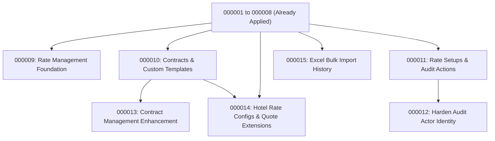

# MIGRATION REVIEW & DEPENDENCY AUDIT REPORT
**WINDOW COMPANIES MANAGEMENT SYSTEM**  
*Date:* November 11, 2026  
*Scope:* Comprehensive Evaluation of Pending Migrations (000009 through 000015)

---

## 1. Executive Summary

The database currently runs migrations `20261104000001` through `20261104000008`. All basic entity tables (`hotels`, `hotel_seasons`, `travel_agencies`, `agency_markets`, `agency_members`, `quotes`, `user_profiles`) exist, but remain empty.

Migrations `20261105000009` through `20261111000015` exist locally in the project repository but have **not yet been applied to the live database**. 

This review provides a technical assessment of each pending migration, verifying its table/column impacts, foreign keys, RLS security policies, dependencies, potential execution errors, and readiness for deployment.

---

## 2. Individual Migration Review

### Migration 000009: `20261105000009_rate_management_foundation.sql`
- **Purpose:** Establishes unique rate sheet versioning, enforces composite foreign key linkage from `hotel_rate_sheets` to `hotel_seasons(id, hotel_id)`, ensures only one published rate sheet per hotel-season, and applies RLS policies.
- **Affected Objects:**
  - Table: `public.hotel_rate_sheets` (Composite FK `fk_rate_sheets_composite_season`, indexes `idx_hotel_rate_sheets_version_unique`, `idx_hotel_rate_sheets_single_published`).
  - Policies: RLS enabled and policies defined for `hotel_rate_sheets`, `hotel_rate_components`, `hotel_rate_outputs`, `agency_special_rates`.
- **Dependencies:** Requires `hotel_seasons` and `hotel_rate_sheets` from `000001`, and `public.is_active_employee()`, `public.can_manage_rates()`, `public.is_admin()` from `000002` and `000006`.
- **Potential Errors / Gotchas:** The script uses `DO $$ ... $$` blocks to check constraints before adding them. In `000001`, `hotel_rate_sheets` was defined with `FOREIGN KEY (hotel_id) REFERENCES hotels(id)` and `season_id UUID NOT NULL`. Adding the composite FK requires `uq_hotel_season_composite` on `hotel_seasons`, which exists in `000001`.
- **Security Assessment:** Enforces that only staff with `CAN_MANAGE_RATES` or `ADMIN` role can mutate rate sheets. Deletions are restricted to draft sheets by admins.
- **Verdict:** **SAFE TO APPLY (Step 1 of Pending Queue)**.

---

### Migration 000010: `20261105000010_contracts_and_custom_rate_templates.sql`
- **Purpose:** Creates `hotel_contracts` and `custom_rate_templates` tables with composite foreign keys, date consistency checks, and RLS policies.
- **Affected Objects:**
  - New Tables: `public.hotel_contracts`, `public.custom_rate_templates`.
  - Policies: Employee read policies, `can_manage_rates()` mutation policies.
- **Dependencies:** Requires `hotels`, `hotel_seasons`, `user_profiles` from `000001`.
- **Potential Errors / Gotchas:** Defines `hotel_contracts` with basic columns (`contract_reference`, `terms_and_conditions`, `document_storage_path`). Migration `000013` extends the contract subsystem further with junction tables. There are no naming conflicts between `000010` and `000013`.
- **Security Assessment:** Documents and templates are protected by RLS; read access requires an active employee profile, and writes require rate management authorization.
- **Verdict:** **SAFE TO APPLY (Step 2 of Pending Queue)**.

---

### Migration 000011: `20261105000011_rate_calculation_setups_and_audit.sql`
- **Purpose:** Creates `rate_calculation_setups` (for flexible, non-slot-bound user calculation configurations) and extends `audit_logs` action check constraint to support granular rate workflow events.
- **Affected Objects:**
  - New Table: `public.rate_calculation_setups`.
  - Constraint: `chk_audit_action` on `public.audit_logs`.
- **Dependencies:** Requires `user_profiles` and `audit_logs` from `000001`.
- **Potential Errors / Gotchas:** `audit_logs` has a check constraint on `action`. Migration 000011 cleanly drops and recreates `chk_audit_action` to include `CALCULATION_SETUP_*` and `RATE_*` action types. Because `audit_logs` has 0 rows, dropping and adding this constraint is instantaneous and risk-free.
- **Security Assessment:** All active employees can view setups; only authorized rate managers can create or modify them.
- **Verdict:** **SAFE TO APPLY (Step 3 of Pending Queue)**.

---

### Migration 000012: `20261105000012_harden_audit_actor_identity.sql`
- **Purpose:** Hardens `audit_logs` against actor spoofing. Implements `enforce_audit_actor_identity()` trigger function to automatically bind `actor_id` to `auth.uid()`, preventing client-side spoofing.
- **Affected Objects:**
  - Function: `public.enforce_audit_actor_identity()`.
  - Trigger: `trg_enforce_audit_actor` on `public.audit_logs`.
  - Policy: `audit_logs_insert_hardened` on `public.audit_logs`.
- **Dependencies:** Requires `audit_logs` from `000001` and `000011`.
- **Potential Errors / Gotchas:** Trigger explicitly supports both authenticated client requests (where `auth.uid()` is bound) and system background triggers (where `auth.uid()` is null, requiring `actor_id` to reference a valid profile).
- **Security Assessment:** Critical hardening measure to guarantee non-repudiation in audit logging.
- **Verdict:** **SAFE TO APPLY (Step 4 of Pending Queue)**.

---

### Migration 000013: `20261109000013_contract_management_system.sql`
- **Purpose:** Enhances the contract management system by introducing:
  - `hotel_contract_seasons`: Many-to-many junction table associating contracts with multiple hotel seasons.
  - `hotel_contract_conditions`: Structured commercial and legal terms with explicit `is_internal_only` segregation flags.
  - `hotel_contract_documents`: Metadata catalog for uploaded contract PDF/DOC files.
  - `hotel_contract_versions`: Immutable version snapshots of agreed contract terms.
  - Storage bucket security policies for the private `contract-documents` bucket.
- **Affected Objects:**
  - New Tables: `hotel_contract_seasons`, `hotel_contract_conditions`, `hotel_contract_documents`, `hotel_contract_versions`.
  - Storage Policies: Read and write policies on `storage.objects` for bucket `contract-documents`.
- **Dependencies:** Requires `hotel_contracts` from `000010`.
- **Potential Errors / Gotchas:** The script includes storage policies on `storage.objects`. If the `contract-documents` bucket does not exist yet in Supabase Storage, the policies still create successfully in Postgres, but file uploads will fail until the bucket is explicitly registered in Supabase Storage.
- **Security Assessment:** Guarantees separation of public client contract terms from confidential internal notes (`is_internal_only`). Storage bucket access is restricted strictly to active employees.
- **Verdict:** **SAFE TO APPLY (Step 5 of Pending Queue)**.

---

### Migration 000014: `20261111000014_hotel_rate_configs_and_history.sql`
- **Purpose:** Creates `hotel_rate_configs` (storing HB base rates, single reduction, triple supplement, and BB reduction components), extends `quotes` table with plain-text email columns and device handoff metadata (`opened_in_app_at`, `confirmed_by`, `confirmed_at`, `confirmation_notes`), and expands `chk_quote_email_status` to include `OPENED_IN_EMAIL_APP` and `USER_CONFIRMED_SENT`.
- **Affected Objects:**
  - New Table: `public.hotel_rate_configs`.
  - Columns Added to `public.quotes`: `email_body_text`, `opened_in_app_at`, `confirmed_by`, `confirmed_at`, `confirmation_notes`.
  - Constraint: `chk_quote_email_status` on `public.quotes`.
  - Indexes: Unique composite index on `(hotel_id, season_id, rate_category, version_number)` and query indexes on `quotes`.
- **Dependencies:** Requires `hotels`, `hotel_seasons`, `quotes`, `user_profiles` from `000001`, and `hotel_contracts` from `000010`.
- **Potential Errors / Gotchas:** `ALTER TABLE quotes ADD COLUMN IF NOT EXISTS ...` is completely safe. The constraint drop and recreate on `chk_quote_email_status` is executed inside a `DO $$` block to prevent failures if already present.
- **Security Assessment:** Closes the gap between rate calculation outputs and immutable quote snapshots.
- **Verdict:** **SAFE TO APPLY (Step 6 of Pending Queue)**.

---

### Migration 000015: `20261111000015_excel_bulk_import_history.sql`
- **Purpose:** Creates `excel_import_history` to track audit logs for Excel bulk import sessions (Hotels, Seasons, Agencies, Markets, Members).
- **Affected Objects:**
  - New Table: `public.excel_import_history`.
  - Policies: RLS enabled with authenticated SELECT and INSERT policies.
- **Dependencies:** Requires `user_profiles` from `000001`.
- **Potential Errors / Gotchas:** Clean standalone table; no breaking dependencies.
- **Security Assessment:** Ensures full auditability for bulk data insertions.
- **Verdict:** **SAFE TO APPLY (Step 7 of Pending Queue)**.

---

## 3. Dependency Graph & Execution Order

All 7 pending migrations are mutually compatible and execute without circular dependencies when applied in numeric sequence: `000009` &rarr; `000010` &rarr; `000011` &rarr; `000012` &rarr; `000013` &rarr; `000014` &rarr; `000015`.

