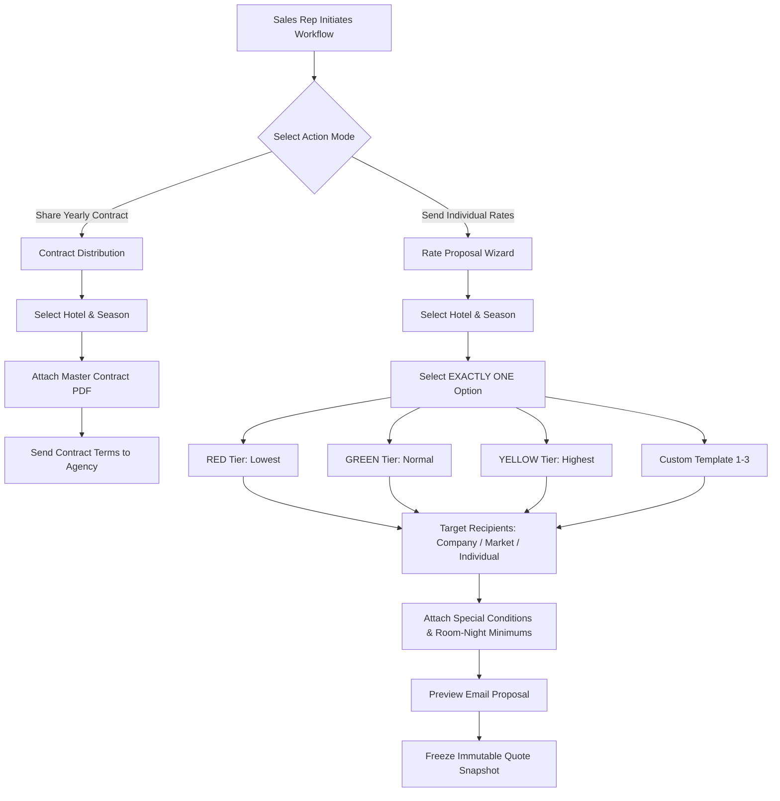

# CONTRACT VS. INDIVIDUAL RATE DESIGN
**Separating Two Distinct Business Concepts in Window Companies CRM**  
**Document Code:** `CONTRACT_VS_INDIVIDUAL_RATE_DESIGN.md`  
**Date:** November 05, 2026  
**Status:** Architecture Decision Record (ADR)  

---

## 1. Problem Statement & Conceptual Boundary

In hospitality CRM operations, mixing master hotel contracts with transactional sales quotes creates severe data corruption and operational confusion:
- **Concept A (Yearly Contract):** The master commercial agreement established between Window Companies (Pvt) Ltd. and a partner hotel (e.g. Mount Randholee Resorts & Spa) valid for 12 months, detailing policies, cancellation release periods, driver accommodation, FOC rules, and full room inventories.
- **Concept B (Individual Colour Rate / Proposal):** A specific, targeted commercial proposal dispatched by a sales representative to a travel agency contact during or following a sales visit, quoting a single pricing tier (Red, Green, Yellow) or negotiated Custom slot (Custom 1, 2, 3) for a selected season and room type.

---

## 2. Structural Separation Rules

```
                      WINDOW COMPANIES CRM
                                │
       ┌────────────────────────┴────────────────────────┐
       ▼                                                 ▼
CONCEPT A: YEARLY HOTEL CONTRACT           CONCEPT B: INDIVIDUAL COLOUR RATE
──────────────────────────────────         ─────────────────────────────────
• Table: public.hotel_contracts            • Tables: hotel_rate_sheets,
• Versioning: Master Legal Versions                  hotel_rate_outputs, quotes
• Scope: Full Year / All Seasons           • Scope: Single Chosen Season & Tier
• Content: Legal Terms, T&Cs,              • Content: Quoted amount, currency,
  Driver FOC, Child Policies,                Special conditions, Notes,
  Cancellation rules                         Room-night commitment
• Recipient: Internal Records Only         • Recipient: Agency / Market / Contact
```

### Rule 1: No Merging in the Same Database Record
- A contract record in `public.hotel_contracts` must **never** double as a quote record in `public.quotes`.
- A quote line item in `public.quote_items` links to a contract via an optional foreign key reference (`contract_id`), but retains its own immutable snapshot values (`quoted_amount`, `rate_category`, `room_type_snapshot`).

### Rule 2: Single-Colour Selection Enforcement
- When a salesperson uses the Rate Sharing Wizard (`/share-rates`), they select **one and only one** pricing option:
  - Option 1: Red Tier (Lowest)
  - Option 2: Green Tier (Normal)
  - Option 3: Yellow Tier (Highest)
  - Option 4: Custom 1, 2, or 3
- The system prevents selecting multiple color tiers in the same dispatch action.

### Rule 3: Separate Sharing Workflows
- **Contract Sharing:** If an agency requests the complete yearly contract PDF (e.g. for contracting teams during annual tariff renewals), this is handled as a complete PDF document dispatch.
- **Rate Proposal Sharing:** Daily sales desk quotes share only the selected room types, meal plan, and single tier rate.
- These two workflows must never be blended into an ambiguous hybrid sending action.

---

## 3. Workflow Flowchart



---

## 4. Architectural Verification

1. **Database Schema:**
   - Table `hotel_contracts` (Migration `20261105000010`) stores master agreements.
   - Table `hotel_rate_outputs` (Migration `20261104000001`) stores tiered pricing per rate sheet.
   - Table `quotes` and `quote_items` freeze the output snapshot independently.
2. **Frontend UI:**
   - `/rates/contracts` handles contract administration and inspection.
   - `/share-rates` handles single-color rate dispatch with terms inspection.

