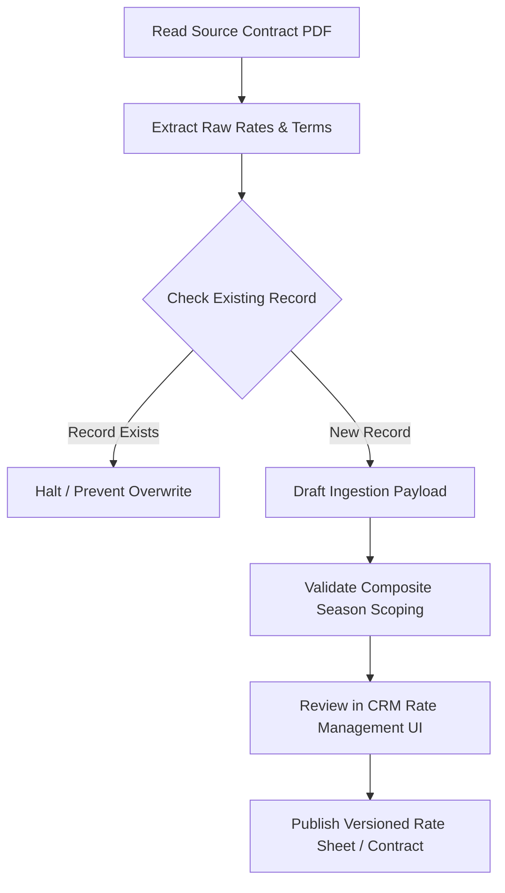

# PHASE 6B-1 — RATE DATA INGESTION PLAN
**Window Companies Management System — Data Ingestion & Tariff Architecture**  
**Document Code:** `PHASE_6B1_RATE_INGESTION_PLAN.md`  
**Date:** November 05, 2026  
**Status:** READY FOR OPERATIONAL EXECUTION (Awaiting Owner Migration Approval)  

---

## 1. Ingestion Strategy & Principles

This plan governs the entry and ingestion of the 12 partner hotel contracts compiled in `All_Hotels_All_Markets_Rate_Sheets.pdf` into the live Supabase tables (`hotel_contracts`, `hotel_rate_sheets`, `hotel_rate_outputs`, and `custom_rate_templates`).

### Strict Ingestion Directives:
1. **Preserve Original Source Values:** Data entry must use exact values from the contract documents without manual alterations.
2. **Document Provenance Tracking:** Every contract record must store the source PDF name and page references in `document_storage_path` or `terms_and_conditions`.
3. **No Duplicate Creation:** Check for existing records matching `(hotel_id, season_id, version_number)` before inserting.
4. **No Inferred Arithmetic:** Where a contract quotes SGL/DBL/TPL across BB/HB/FB explicitly, enter those numbers directly into `hotel_rate_outputs`. Never invent formulas to derive them.
5. **Preview Before Commit:** All ingested records must be reviewable in the Rate Management UI (`/rates`) before activating or publishing.

---

## 2. Ingestion Matrix for the 12 Partner Hotels

| Hotel Key | Source Property Name | Source PDF Pages | Season Labels & Periods | Base Currency | Ingestion Scope |
| :---: | :--- | :---: | :--- | :---: | :--- |
| **H-01** | Mount Randholee Resorts & Spa | pp. 2–6 | Summer 2026 (01.04–31.10.2026) Winter 2026/27 (01.11.2026–31.03.2027) | USD | Master Contract + Superior Deluxe Rate Sheet (SGL/DBL/TPL on BB/HB/FB) |
| **H-02** | Serenique Resort Kandy | pp. 7–9 | Winter 2026/27 (01.11.2026–30.04.2027) Summer 2026 (01.05–31.10.2026) | USD | Master Contract + Deluxe Room Rate Sheet (SGL/DBL/TPL/QUAD on BB/HB/FB) |
| **H-03** | Rivendell Hotel | pp. 10–13 | Summer 2026 (01.03–31.10.2026) Winter 2026/27 (01.11.2026–28.02.2027) | USD | Master Contract + Standard/Deluxe/Suite Rate Sheets |
| **H-04** | Manarala Villa | pp. 14–19 | Winter/Summer (2025/2026) | USD / LKR | Prior-year filing; flagged in conflict report. |
| **H-05** | Highland Stone House | pp. 20–23 | Summer 2026 (01.07–31.10.2026) Winter 2026/27 (01.11.2026–30.04.2027) | USD | Master Contract + Explicit Tax Exclusive Note (VAT/SSCL) |
| **H-06** | Horton Heights Hotel | pp. 24–26 | Winter 2026/27 (01.11.2026–30.04.2027) Summer 2027 (01.05–31.10.2027) | USD | Master Contract + Deluxe Rooms + Suite Supplements |
| **H-07** | The Deer Park Hotel | pp. 27–31 | Calendar 2026 (01.01–31.12.2026) Calendar 2027 (01.01–31.12.2027) | USD | Master Contract + Superior/Duplex/Angsana Cottages |
| **H-08** | The Agbo Hotel | pp. 32–35 | Winter 2025/26 (01.11.2025–30.04.2026) Summer 2026 (01.05–31.10.2026) | USD | Master Contract + Deluxe Room (SGL/DBL/TPL) |
| **H-09** | Pearl Grand by Rathna | pp. 36–40 | Summer 2026 (01.05–31.10.2026) Winter 2026/27 (01.11.2026–30.04.2027) | USD | Master Contract + Superior/Deluxe/Suite (RO/BB/HB/FB) |
| **H-10** | Rathna Beach Resort | pp. 41–45 | Winter 2026/27 (01.11.2026–30.04.2027) | USD | Master Contract + Superior/Deluxe Sea View |
| **H-11** | Grand Beragala Boutique Resort | pp. 46–49 | Period 1 (01.07–30.11.2026) Period 2 (01.12.2026–30.04.2027) | USD | Master Contract + Explicit Tax Exclusive Note |
| **H-12** | The Thinnai Hotel | pp. 50–58 | Asian Market (2027/28) European Market (2027/28) | USD | 2 Master Contracts (Version 17BW & 18BW) |

---

## 3. Data Entry Validation Workflow

1. **Pre-Ingestion Check:** The ingestion routine queries `hotel_contracts` and `hotel_rate_sheets` by reference and version number. If a matching record already exists, insertion is blocked.
2. **Audit Logging:** Every inserted rate sheet or contract is linked to `created_by` (authenticated Admin user) with an audit event recorded in `public.audit_logs`.
3. **Draft Status:** All new rate sheets are initially created in `DRAFT` status, allowing the commercial team to inspect them before setting `status = 'PUBLISHED'`.

