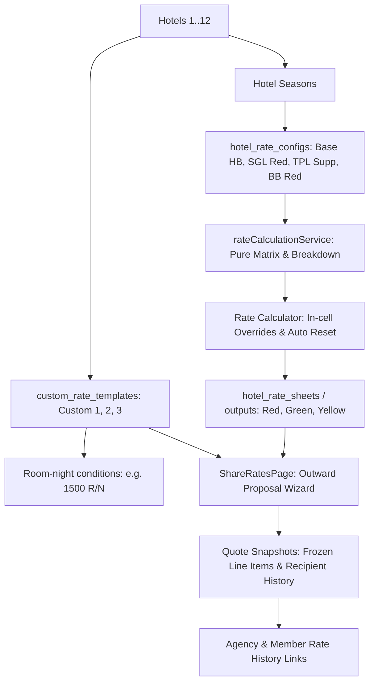

# Phase 9: Hotel Rate Management Architecture Specification
**Window Companies (Pvt) Ltd. — CRM Project**  
**Date:** November 11–12, 2026 (Phase 9)  
**Status:** Architecture Implemented & Documented

---

## 1. Executive Summary
Phase 9 integrates the complete hotel-specific rate configuration, calculation engine, Red/Green/Yellow category tiers, Custom 1/2/3 options, room-night conditions, and previous agency/member quote history into the Window Companies CRM.

This architecture preserves the strict business separation between:
1. **Red / Green / Yellow** standard commercial pricing tiers.
2. **Custom 1 / Custom 2 / Custom 3** negotiated rate options.
3. **Optional user-created calculation setups** (unlimited, dynamic 2-axis delta templates).
4. **Agency-specific negotiated VIP rate slots** (Special Rate 1/2/3).

---

## 2. System Architecture & Component Mapping

### 2.1 Core Entities & Database Roles

1. **`hotel_rate_configs` (Draft Migration 000014)**:
   - Holds hotel-specific formula components: `hb_double_base_rate`, `single_reduction_amount`, `triple_supplement_amount`, `bb_reduction_amount`.
   - Units explicitly stored (e.g. `PER_ROOM_PER_NIGHT`).
   - `is_formula_verified` boolean ensures unconfirmed calculations are never masqueraded as official corporate figures.

2. **`custom_rate_templates` (Migration 000010)**:
   - Holds commercial slots: `Custom 1`, `Custom 2`, `Custom 3`.
   - Incorporates `room_night_condition` (e.g. 1,500 room nights), date validity windows, and commercial deal notes.

3. **`rateCalculationService.ts`**:
   - Pure, decoupled calculation engine.
   - Computes:
     - $\text{Double HB} = \text{Anchor Base}$
     - $\text{Single HB} = \text{Double HB} - \text{Single Reduction}$
     - $\text{Triple HB} = \text{Double HB} + \text{Triple Supplement}$
     - $\text{Double BB} = \text{Double HB} - \text{BB Reduction}$
     - $\text{Single BB} = \text{Single HB} - \text{BB Reduction}$
     - $\text{Triple BB} = \text{Triple HB} - \text{BB Reduction}$
   - Returns step-by-step breakdown explanations and verification warnings.

4. **`QuoteHistoryView.tsx` & `quoteService.ts`**:
   - Stores immutable quotes linking agency, market, contacts, contract version, rate category, and line item values.
   - Accessible directly from Travel Agencies (`/rates?agencyId=...&tab=HISTORY`) and Members (`/rates?memberId=...&tab=HISTORY`).

